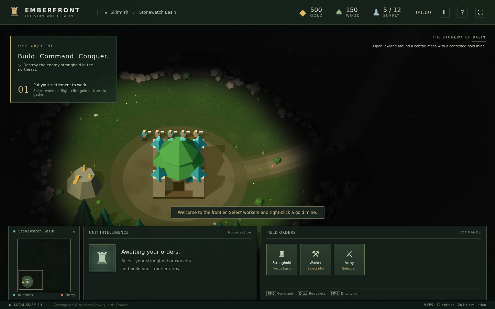
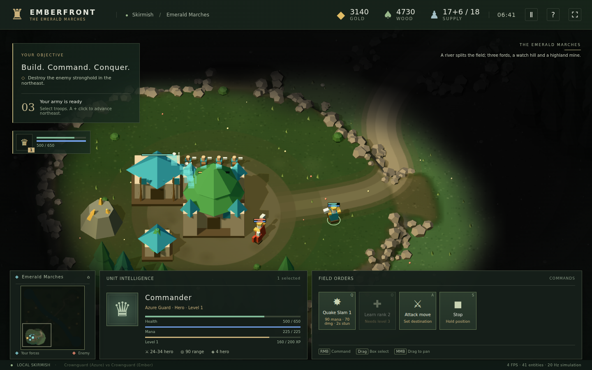
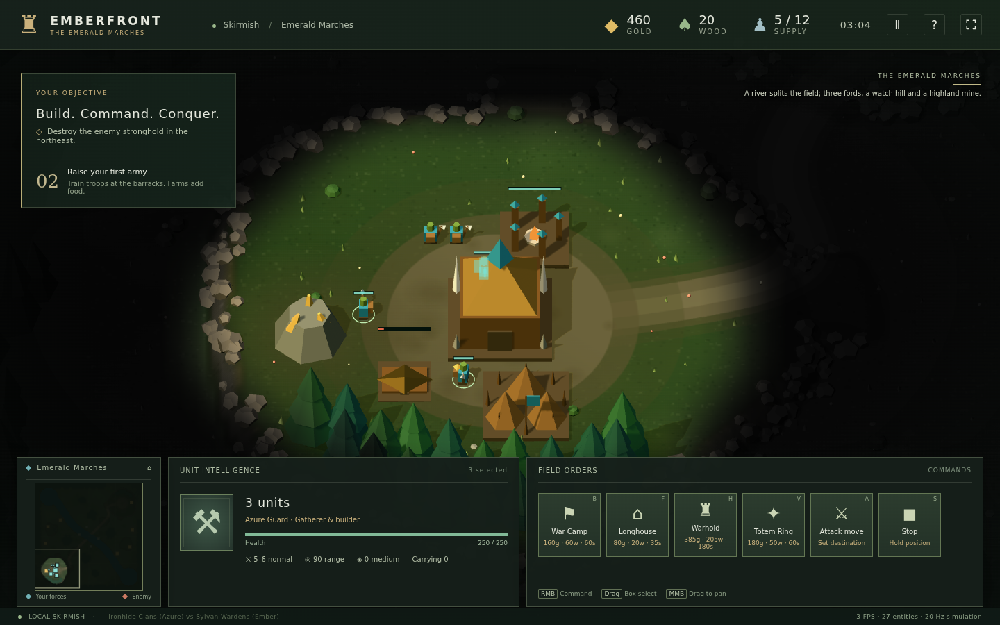
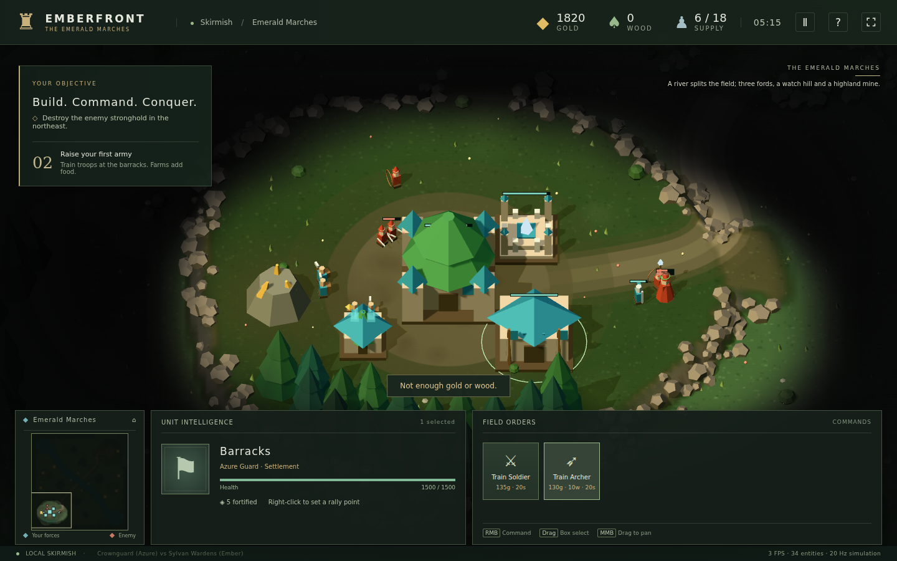

# EMBERFRONT 试玩评估

> 评估日期：2026-10-29  
> 评估版本：工作区当前版本（HEAD `51d14b9`，含未提交改动）  
> 评估对象：`npm run dev` 本地浏览器版，Emerald Marches 与 Stonewatch Basin  
> 评估方式：人工试玩 + Playwright 自动操作 + 加速模拟 + 内置 AI 对战  
> 代码改动：**未修改任何源代码**。本文档与 `docs/evaluation/` 下的截图是唯一新增文件。

---

## 0. 结论先行

**这是一款底子明显好于普通“演示原型”的 RTS：画面有统一风格，核心循环完整，英雄、迷雾、AI、两套地图和测试体系都已经跑通。** 如果目标是继续打磨成可对外试玩的版本，它值得投入。

但当前版本还不能称为“平衡、顺畅、可推荐给新玩家”的游戏。试玩中反复出现三类问题：

1. **经济与建造的可靠性**：建造命令会把已经在施工的工人改派走，导致前一个地基永久停在 0%；工人建完后不回到原资源，5 工人经济很容易瞬间停摆。
2. **战斗信息与防守反馈**：AI 第一波压进主基地时没有全局警报，工人和部队不会自动回防；玩家往往在发现时已经损失了工人、地基和兵营队列。
3. **难度与节奏**：AI 最早约 4:30 就开始带约 5 个单位接近玩家基地，7 分钟可累积到 12 个；而正常开局此时只有 1～4 个战斗单位，英雄经常还没造出来。与此同时 AI vs AI 连续 4 局 30 分钟都无法分出胜负。

**作为原型：6.5 / 10。作为可公开试玩的 RTS：约 4 / 10。**  
最优先修的不是美术，而是**建造分配、经济自动化、基地告警、AI 难度档位**这四件事。

| 维度 | 评分 | 简评 |
| --- | ---: | --- |
| 视觉与氛围 | 4.5 / 5 | 低多边形风格统一，阵营色、地形、迷雾、英雄头像都可读 |
| 界面与信息架构 | 3.5 / 5 | HUD 完整、快捷键清楚，但遮挡、补给阻塞和战斗反馈不足 |
| 上手与引导 | 3 / 5 | 开始界面、目标面板、战地手册都很好；缺少难度选择与阵营数值对比 |
| 经济与建造 | 2 / 5 | 资源循环完整，但建造者分配、工人回岗、木材可达性有明显问题 |
| 战斗与英雄 | 3 / 5 | 攻击移动、集火、Q 技能、升级都能用；反馈弱，英雄成长在短局中偏慢 |
| AI 与难度 | 2 / 5 | AI 会扩张、造英雄、成波进攻；但前期过强、AI 互打又无法收官 |
| 性能与稳定 | 3.5 / 5 | 60 项测试通过，无页面报错，158 draw calls；硬件帧率未验证 |
| 音频 | 0 / 5 | 当前没有音频；对 RTS 的沉浸感和战斗反馈影响很大 |
| 完成度 | 3 / 5 | 核心闭环完整，但缺少科技树、存档、多人、难度与大量 QoL |

---

## 1. 测试环境与方法

| 项目 | 内容 |
| --- | --- |
| 系统 | Linux |
| Node | v24.14.0 |
| 浏览器 | Playwright Chromium 1.64.1，headless，1440×900 |
| 渲染 | SwiftShader 软件 WebGL（`--use-angle=swiftshader`） |
| 版本 | 当前工作区；`npm test` 60/60 通过 |
| 加速方式 | 在开发模式下调用 `window.rts.world.step()` 快进模拟；命令仍通过真实鼠标/键盘/UI 发出 |
| 沙盒 | 一场后期验证中临时注入 5000 金/木，用于测试英雄与正面战斗；文中会明确标注 |
| 限制 | 软件渲染只有约 2～11 FPS，**不能用于判断真实硬件帧率**；只有一名试玩者；未测试桌面版、触屏、联机和存档 |

### 试玩场次

| 场次 | 阵营 | 地图 | 目的 | 结果 |
| --- | --- | --- | --- | --- |
| A | Ironhide vs Sylvan | Emerald Marches | 完整正常开局：采集、建造、出兵、被 AI 进攻 | 7:45 主基地被毁 |
| B | Crownguard vs Crownguard | Emerald Marches | 沙盒资源下测试英雄、Q 技能、正面防守 | 7:28 主基地被毁 |
| C | Crownguard vs Sylvan | Emerald Marches | 优化开局：4 采集 + 1 专职建造 | 5:15 前后 AI 压入基地，军队被打光 |
| D | AI vs AI ×4 | Emerald Marches | 30 分钟模拟、平衡与稳定性 | 4/4 局 30 分钟无结果 |
| E | — | Stonewatch Basin | 第二张地图加载与视觉检查 | 正常加载，523 entities |

> 说明：A 场第一次木材操作点在了树的地面锚点，而不是可见树冠，导致选中了后方不可达的树；后续用树冠点击复测，木材采集本身是可行的。这是操作判定问题，不是“木材系统完全不可用”，但仍然是真实的易用性问题，见 P1-2。

---

## 2. 做得好的地方

### 2.1 视觉与界面有明确的产品感

开始界面、HUD、目标面板、单位卡、英雄卡、小地图、暂停/结算弹窗都保持了同一套暗色 + 米色 + 阵营色的视觉语言。低多边形单位虽然简单，但阵营色、轮廓和血条足以支撑 RTS 的可读性。Stonewatch 的地图缩略图、地形配色与 Emerald 的河流/高地有明显区别；中央台地需要探索后才能看到。


*开始界面：阵营、对手、地图三组卡片清楚，背景是冻结的战场。*



*Stonewatch Basin 开局：与 Emerald 不同的地形配色和迷雾；中央台地需要探索后才能看到。*

### 2.2 核心循环是完整的

从 5 个工人、500 金/150 木开始，采集 → 农场 → 兵营 → 祭坛 → 英雄 → 部队 → 进攻/防守的链路都能走通。队列、退款、人口预留、建造取消、集结点、编队、攻击移动、英雄技能、复活计时界面、迷雾、小地图这些“RTS 该有的东西”不是占位符，而是真的接入了模拟。

### 2.3 英雄系统完成度高于预期

英雄头像常驻左侧，等级、生命、法力、技能点、眩晕、复活进度都有位置；F1 选中/定位、O 学技能、Q 施法的流程顺畅。1 级 Quake Slam 的 90 法力、8 秒冷却、范围眩晕都能生效。



*英雄卡与技能按钮；1 级英雄 521/650 生命、225 法力，技能已学会。*

### 2.4 工程与测试基础扎实

- `npm test`：3 个测试文件、60 项测试全部通过。
- `npm run test:render`：中盘 645 entities / 841 meshes / 158 draw calls，通过预算。
- AI vs AI 连续 4 局、每局 30 分钟模拟，无崩溃；实际耗时约 16 秒/局。
- 试玩过程中没有出现页面异常或控制台错误。
- 模拟与渲染分离、20 Hz 固定步长、确定性随机，这些底层选择为后续平衡和回归测试打了很好的基础。

复现命令：

```bash
npm test
npm run test:render
npm run battle -- --games 4 --minutes 30 --seed 1
```

---

## 3. 关键问题与改进建议

### P0-1　建造命令会“偷走”已有工地的工人，地基永久停在 0%

**严重度：S1（阻断正常开局）**

#### 现象

选中多名工人后连续放置多个建筑，后一个建造命令会把**已经在施工的工人**重新分配给新建筑。前一个地基没有施工者，但界面不会提示，工人也不会自动回到工地。

#### 证据

受控复现（3 名工人，连续放农场 / 兵营 / 祭坛）：

- 放农场后：工人 4 → 农场；
- 放兵营后：工人 4 → 农场，工人 6 → 兵营；
- 放祭坛后：工人 6 的目标从兵营 625 **改成祭坛 626**；
- 100 秒后：农场 100%，祭坛 100%，**兵营 0%，无施工者**。

另一场正常开局中，农场在 3:04 仍为 0%，资源 460 金 / 20 木，人口 5/12；如果玩家不手动派工人接手，它会一直停在 0%。



*3:04：基地与兵营/祭坛已成型，但左下角农场仍是地基；木材只剩 20，人口上限没有增加。*

#### 影响

- 玩家会误以为人口/科技在推进，实际经济被锁死。
- 5 工人开局下，这种损失非常致命：少一个农场就少 6 人口，英雄/部队队列会卡住。
- 这是“规则没有错，但体验像 bug”的典型问题；比单纯数值不平衡更伤信任。

**定位线索**：建造命令按距离排序选择工人，但没有排除 `order.type === "build"` 的工人；`build()` 完成时直接把 order 设为 `idle`。这两处叠加，造成了“后一个建筑抢走前一个建筑的工人”。

#### 建议

1. **分配建造者时排除已经在建造的工人**：优先选择空闲工人；没有空闲工人时，明确提示“没有可用工人”，而不是抢走已有施工者。
2. **在地基上显示施工人数**：`0 builders` 用红色/警告色显示；小地图上给未施工地基一个脉冲标记。
3. **自动补位**：地基超过 3 秒没有施工者时，自动派最近的空闲工人；没有空闲工人则 toast + 小地图提示。
4. **建造命令排队**：Shift + 放置多个建筑时，按顺序预留不同工人，工人完成一个再去下一个。
5. **回归测试**：增加“3 个工人连续放 3 个建筑，100 秒后三个都完工”的模拟测试；这是很容易被遗漏的路径。

---

### P0-2　主基地被攻击没有全局提示，工人/部队也不会自动回防

**严重度：S1（玩家会在没反应过来的情况下输掉）**

#### 现象

AI 部队进入主基地、攻击工人和建筑时：

- 没有声音；
- 没有小地图红点/脉冲；
- 没有屏幕边缘红色闪烁；
- 没有“Your stronghold is under attack” toast；
- 附近待命部队不会自动回防；
- 工人不会逃跑或躲进主基地。

玩家只能碰巧看到单位血条下降，或者等主基地血量已经很低才发现。

#### 证据

优化开局在 5:15 左右：

- 金 1820、木 0、人口 6/18；
- 主基地旁已经有敌方近战/远程单位；
- 祭坛停在 93%；第二农场在 3:37 时为 80%，到 5:16 已从建筑列表消失（很可能被 AI 拆掉）；
- 玩家只有 1 名士兵（5:30 时已残血至 46/420）；
- 界面没有任何“基地被攻击”的提示，只有单位自己的血条。



*5:15：AI 已进入主基地，玩家金 1820、木 0，祭坛 93%，只有 1 名士兵；没有任何基地告警。*

#### 影响

- RTS 的基地告警是基础设施，不是“锦上添花”。没有它，玩家必须一直盯着小地图，体验会非常累。
- 工人被杀 → 经济停摆；地基无人施工 → 科技断档；部队没回防 → 主基地被快速拆掉。
- 当前 AI 会优先攻击工人和建造者，这个行为本身合理，但玩家没有对应的信息与自动反应手段。

#### 建议

1. **基地/资源点被攻击时触发全局告警**：toast + 小地图脉冲 + 屏幕边缘红色 vignette；可选的短促音效。
2. **给“自动回防”一个默认姿态**：待命部队在基地半径 12～15 内自动攻击入侵者；玩家可以切换“坚守/自动回防”。
3. **工人遇袭逃跑**：工人被攻击时自动跑向最近主基地，或进入“躲藏”状态；至少不要在原地继续采矿。
4. **加一座防御建筑**：Watchtower / 箭塔（例如 150 金 40 木，700 生命，12～18 穿刺，射程 500），让玩家在 5～7 分钟有一张“防守牌”。
5. **主基地血量/护甲**：当前 1500 生命、5 点城甲，10 个单位可以在很短时间内拆掉；可以考虑 2200～2500 生命，或让主基地具备基础自卫火力。

---

### P0-3　AI 第一波太早、太强，10～15 分钟的目标节奏没有成立

**严重度：S1（直接决定新玩家是否愿意再开一局）**

#### 现象

- 正常/优化开局在 **4:30～6:40** 就会被 AI 第一波压入主基地；
- 此时玩家通常只有 **1～4 个战斗单位**，英雄经常未训练完成或买不起；
- 沙盒资源下 4 个士兵 + 1 级英雄，在 7:09 面对 12 个敌方单位；7:22 英雄仅剩 94 血，7:28 主基地被毁；
- 正常开局 A 场 7:45 主基地被毁；
- AI vs AI 4/4 局 30 分钟无结果，结束时 AI 仍有 25,000+ 金未花，说明双方都撞在 100 人口上限上互相消耗，无法收官。

#### 证据

| 场次 | 首次接敌 | 玩家兵力 | 结果 |
| --- | --- | --- | --- |
| A（Ironhide） | 4:27 起有敌人接近，5:13 军队被打光 | 3 个近战，无英雄 | 7:45 主基地被毁 |
| B（沙盒 Crownguard） | 7:09 已有 12 个敌军 | 4 个士兵 + 1 级英雄 | 7:28 失败 |
| C（优化 Crownguard） | 5:15 前后已进入基地 | 1 个士兵，祭坛 93% | 军队被打光 |
| AI vs AI ×4 | — | 双方各训练 168～181 个单位 | 30:00 无结果 |


*7:44 主基地陷落结算；本局从 4:27 起被 AI 持续压制，军队在 5:13 前后被打光。*

#### 影响

- 新玩家在“刚学会造兵营”的阶段就被打崩，很难体验到英雄、迷雾、分矿、正面团战这些中后期内容。
- 目标单局 10～15 分钟，但实际是“7 分钟被 AI 打死”或“AI 互打 30 分钟不结束”，两端都不对。
- AI 的运营明显强于普通玩家：它会补工人、造第二基地、造英雄、成波进攻；玩家还在学习建造时，它已经在执行成熟战术。

#### 建议

1. **增加难度档位**：Easy / Normal / Hard。Easy 第一波 10～12 分钟、3～4 个单位；Normal 8～9 分钟、4～6 个；Hard 6～7 分钟、6～8 个。当前更接近“Hard”。
2. **AI 第一波延后**：至少在玩家拥有 5 个战斗单位或 8 分钟后再发动第一次成建制进攻。前期只派 1～2 个骚扰单位。
3. **AI 扩张/英雄节奏放缓**：第二基地、祭坛、英雄的优先级在前期降低；先保证玩家能看懂 AI 在做什么。
4. **AI 遵守战争迷雾**：当前 AI 掌握全图信息（README 已注明）。如果保留这个设定，应在难度界面明确标注“AI 全图”；否则默认应受迷雾限制。
5. **给 AI 一个“收官”手段**：AI vs AI 的 30 分钟僵局说明缺少攻城/终结能力。可以增加攻城单位、对建筑的额外伤害、或 25 分钟后“突然死亡”（金矿枯竭/主基地持续掉血/分数判定）。
6. **调整英雄可得性**：425 金 / 100 木 / 55 秒在当前经济下太晚；建议降到 350 金 / 80 木 / 45 秒，或把祭坛降到 150 金 / 40 木。否则玩家在 AI 第一波前很难同时拥有英雄和部队。

---

### P1-1　工人完成建造后不回到原资源，5 工人经济容易瞬间停摆

**严重度：S2（高频、影响运营手感）**

#### 现象

工人被拉去建造后，建筑完成就进入 `idle`，不会回到原来的金矿/树林。5 工人开局下，只要 1～2 个工人被建造占用，金/木收入就会明显下降；如果被占用的是唯一的木工，木材会直接归零。

#### 证据

优化开局：

- 3:37 时金 **1610**、木 **0**；
- 5:15 时金 **1820**、木 **0**，祭坛停在 93%，第二农场在 3:37 为 80%、5:16 前已从建筑列表消失；
- 唯一被拉去建造的工人没有回到树林，也没有其他工人补位，木材收入归零；
- 玩家有足够金子，却因为木材为 0 无法造弓箭手/继续建造，弹出泛化的 “Not enough gold or wood.”。

这与“工人建完自动回岗”的 RTS 惯例不符，也不符合 5 工人小经济体的容错需求。

**定位线索**：`build()` 在建筑完成时把工人 order 设为 `idle`，没有保存/恢复建造前的采集目标。

#### 建议

1. **建造完成后自动回到上一个采集目标**；如果目标已耗尽，则寻找最近同类资源。
2. **在工人卡上显示“空闲/采集/建造”**，并在顶部资源条旁显示 idle worker 数量。
3. **“Return to work” 快捷键/按钮**：选中空闲工人后一键回到最近资源。
4. **建造时保留原采集记录**：至少记录 `lastGatherKind`，不要只存当前 order。
5. **木材/黄金分配提示**：当木材为 0 且有人口/建造需求时，给出“木材收入为 0，建议派工人伐木”的提示，而不是只在训练时弹“资源不足”。

---

### P1-2　资源与建筑的点击判定不可靠：树、建筑遮挡、地基

**严重度：S2（第一次采集就可能踩到）**

#### 现象

- 点击树的**地面锚点/树干下部**时，射线会选中树后方 2 格的另一棵树；那棵树的交互点被前排树挡住，工人走不过去，约 6 秒后放弃并 idle。
- 点击可见的**树冠**则正常：工人会去采前排树，60 秒后木材从 150 涨到 210。
- 主基地后面的祭坛会被基地的高大模型遮挡，点击祭坛位置会选中主基地；试玩中只能通过调试选择绕过。
- 建造预览的红色/绿色是可读的，但“这里有个单位站着”只在点击后以 toast 出现，没有在预览阶段提前标红。

#### 证据

- 在坐标 (19,13) 的树，地面投影点击返回 (19,11) 的树；工人 6 秒后 idle，木材 150 不变。
- 同一棵树点击树冠（屏幕 y≈340）返回 (19,13) 的树；60 秒后木材 210，两名工人正常往返。
- 祭坛放在主基地北侧时，点击祭坛屏幕位置返回 “Stronghold” 选择卡。

#### 建议

1. **资源选择用“树冠/树干整体 + 最近可达点”判定**：点击森林时优先选最近、可到达、可交互的树，而不是射线最先碰到的树。
2. **悬停高亮**：鼠标悬停资源/建筑时显示轮廓和名称；不可达时显示红色“不可达”。
3. **建造预览阶段检查单位占位**：预览就把“有单位”标红，而不是点击后才 toast。
4. **建筑循环选择**：Tab / 建筑列表 / 小地图建筑图标，解决高模型互相遮挡；至少让被遮挡的建筑可通过头像或列表选中。
5. **点击优先级**：单位 > 资源 > 建筑，或提供“只选单位/只选建筑”的修饰键；当前建筑模型过大，容易抢走点击。

---

### P1-3　补给阻塞与生产队列不透明

**严重度：S2（玩家不知道为什么不出兵）**

#### 现象

- 顶部显示 `17+6/18` 这类“已用 + 预留 / 上限”，但没有明确的 “Supply blocked” 状态；
- 队列里有 6 个项目，界面只显示 “Queued”，不说明是等待人口、等待资源还是卡在出生点；
- 农场被拆后人口上限下降，队列会静默停住；
- 训练失败只给 “Not enough gold or wood.”，不区分缺金还是缺木。

#### 建议

1. 顶部资源条增加 **SUPPLY BLOCKED** 红色徽标；人口满时训练按钮显示“需要农场”。
2. 队列项显示阻塞原因：`Waiting for supply` / `No spawn space` / `Barracks destroyed`。
3. 训练按钮在资源不足时保持可点击但弹出具体原因（缺多少金/木/人口），而不是只变灰。
4. 农场/主基地被毁时给明确提示：“人口上限 -6，队列暂停”。
5. 生产建筑增加“重复训练”开关，减少连续点击。

---

### P1-4　英雄成长与技能反馈偏弱

**严重度：S2（英雄是卖点，但短局里很难感受到成长）**

#### 现象

- 1 级英雄击杀 4 个单位后经验 160/200，仍未升到 2 级；
- 技能 rank 2 需要英雄 3 级（500 XP），rank 3 需要 5 级（1400 XP）；在 7～8 分钟的失败局里，玩家通常只能停在 1 级、rank 1；
- Q 技能有法力消耗和冷却，但视觉反馈只有约 0.5 秒的粒子，低帧率/混乱团战中很容易错过；
- 没有伤害数字、没有击杀提示、没有技能命中音效；
- 英雄阵亡后祭坛被拆，玩家没有明显提示“英雄无法复活”。

#### 建议

1. **调整成长曲线**：rank 2 改为英雄 2 级、rank 3 改为 4 级；或提高击杀经验 30～50%；让 10～15 分钟局能稳定看到 2 级技能。
2. **技能反馈**：更明显的范围圈、地面裂纹、屏幕轻震、命中数字、低沉音效；冷却用环形进度。
3. **升级提示**：升级时弹出“技能点 +1，按 O 学习”，不要只在小头像上显示一个数字。
4. **阵亡/复活提示**：英雄阵亡 toast + 祭坛被毁时提示“英雄无法复活，需要重建祭坛”。
5. **英雄定位**：目前英雄更像“更贵的步兵”，缺少能改变战局的时刻；可以考虑 2 级技能质变、或让英雄初始带一个被动光环。

---

### P2-1　AI vs AI 30 分钟僵局，缺少收官手段

4 局 AI 对 AI 全部在 30:00 无结果；双方各训练 168～181 个单位、损失 155～174 个，结束时仍有 25,000+ 金。双方都撞在 100 人口上限，成波互耗，但谁也拆不掉对方主基地。

**建议**：给 AI 明确的“集火主基地/拆家”逻辑；增加攻城单位或对建筑加成；25 分钟后进入 sudden death（金矿枯竭、主基地持续掉血、或按击杀/经济分数判定）。这也会让玩家观战模式更有观赏性。

### P2-2　开始界面与引导还可以更像“产品”

- 阵营卡片只有风味文字，没有近战/远程/英雄的数值对比；新玩家无法判断 Ironhide 和 Sylvan 的差异。
- 没有难度选择；建议在 Start battle 旁加 Easy / Normal / Hard，并显示“推荐第一次玩 Normal”。
- 战地手册内容完整，但 `?` 按钮没有可访问名称；弹窗没有明显的关闭按钮（只能 Esc/Resume）。
- 没有 UI 缩放、色盲模式、字幕/音量设置；在 1440×900 下单位血条已经偏小。
- 没有音频：至少加入 UI 点击、建造完成、攻击、死亡、英雄技能、基地告警这几类短音效，性价比很高。

### P2-3　性能与技术观察

- 中盘 645 entities / 841 meshes / 158 draw calls，draw call 预算通过。
- 30 分钟 AI vs AI 模拟约 16 秒真实时间，模拟性能很好。
- 但 841 个 mesh 中大量是树木；建议对静态树木做合批/instancing/LOD，为后续 100 单位团战留余量。
- 软件渲染 2～11 FPS 不能代表硬件；需要在 1920×1080、硬件加速的 Chrome/Edge 上补一次真实帧率与 30 分钟内存测试。
- 目前没有看到崩溃、资源负数、重复伤害等严重逻辑问题；60 项测试全部通过，基础稳定性值得肯定。

---

## 4. 建议的优先级路线

### 第一优先（下一次试玩前必须修）

1. **建造者分配**：不允许抢走已在施工的工人；地基 0 施工者要显式告警；补回归测试。
2. **工人回岗**：建造完成后自动回到原资源；没有原资源则找最近同类。
3. **基地告警 + 自动回防**：toast、小地图脉冲、屏幕边缘提示；待命部队自动防守；工人遇袭逃跑。
4. **难度档位**：至少 Easy / Normal 两档；Normal 第一波延后到 8～9 分钟，规模 4～6 个单位。
5. **资源点击判定**：森林点击优先最近可达树；建筑遮挡提供 Tab 循环或列表选择。

### 第二优先（决定“能不能玩得舒服”）

6. 补给阻塞/队列原因/训练失败原因的具体化。
7. 英雄经验与 rank 门槛调整；Q 技能反馈增强。
8. 加一座防御建筑（Watchtower）或提升主基地生存能力。
9. 音频最小集：UI、建造完成、攻击、死亡、基地告警、技能。
10. 开始界面增加难度与阵营数值对比。

### 第三优先（决定“能不能长期玩”）

11. AI vs AI 收官逻辑 / sudden death / 攻城单位。
12. 科技树、分矿引导、存档/回放、多人。
13. UI 缩放、色盲模式、键位重映射、手柄/触屏（如目标包含）。

---

## 5. 具体数值建议（供平衡讨论）

| 项目 | 当前 | 建议 | 理由 |
| --- | --- | --- | --- |
| 英雄成本 | 425 金 / 100 木 / 55 秒 | 350 金 / 80 木 / 45 秒 | 当前 5 分钟前很难同时拥有英雄和部队 |
| 祭坛成本 | 180 金 / 50 木 / 60 秒 | 150 金 / 40 木 / 50 秒 | 降低英雄门槛，让祭坛更早进入建造序列 |
| 第一波 AI | 约 4:30 开始接近，5 分钟约 5 个，7 分钟可到 12 个 | Normal：8～9 分钟，4～6 个单位；Easy：10～12 分钟，3～4 个 | 让玩家先体验建造/英雄/第一次团战 |
| 主基地生命 | 1500 | 2200～2500，或加基础自卫攻击 | 当前 10 个单位可快速拆家，缺少翻盘窗口 |
| 防御建筑 | 无 | Watchtower 150 金 / 40 木，700 生命，12～18 穿刺，射程 500 | 给玩家一张明确的防守牌 |
| 英雄 rank 2 | 英雄 3 级（500 XP） | 英雄 2 级（200 XP） | 10～15 分钟局能体验到技能成长 |
| 英雄 rank 3 | 英雄 5 级（1400 XP） | 英雄 4 级（900 XP） | 同上 |
| 木材起始 | 150 | 200～250，或降低祭坛/弓手木材 | 当前 150 木在农场+兵营+祭坛后只剩 20 |
| 工人建造后 | idle | 自动回原资源 | 5 工人经济容错太低 |
| AI 第二基地 | 约 6 分钟前 | Normal 8 分钟后；Easy 10 分钟后 | 避免 AI 经济滚雪球过早 |

> 这些数值只是方向性建议，不需要一次全部改；建议先做“工人回岗 + 建造者分配 + 基地告警 + 难度档位”，再根据新试玩数据微调。

---

## 6. 建议补充的测试

1. **建造者分配**：3 个工人连续放 3 个建筑，100 秒后三个都完工；不允许出现 0 施工者的地基。
2. **工人回岗**：工人从金矿/树林被拉去建造，完成后 order 回到原资源；原资源耗尽时找最近同类。
3. **资源点击**：点击树冠/树干/地面锚点都能选中同一棵最近可达树；不可达时立即提示，不允许“6 秒后悄悄 idle”。
4. **基地告警**：敌人进入基地半径时触发 toast + 小地图标记；待命部队自动回防。
5. **补给阻塞**：人口满时队列显示原因；农场被拆后队列暂停并提示。
6. **AI 节奏**：固定 seed 下第一波时间/规模落在难度档位范围内；AI vs AI 30 分钟内至少能出现一次主基地被毁或进入 sudden death。
7. **英雄成长**：7～8 分钟正常对局中，英雄至少能到 2 级并点出 rank 2。
8. **硬件性能**：1920×1080 硬件加速，30 分钟，记录 p95 帧耗时、内存、draw calls；不要用 SwiftShader 数据做结论。

---

## 7. 总结

EMBERFRONT 已经跨过了“能不能玩”的门槛：它有完整的资源—建造—出兵—英雄—战斗闭环，有视觉识别度，有迷雾和两张地图，也有可靠的测试基础。**它现在最缺的不是更多内容，而是把已有内容做得可信、可读、可预期。**

如果只能改三件事，我建议是：

1. **让建造命令不再偷走工人，并让工人建完自动回岗。**
2. **给主基地被攻击一个明确告警，并让部队/工人有基本的自动反应。**
3. **加难度档位，把 AI 第一波从 4.5～6 分钟推到 8～9 分钟，同时给 AI 一个 30 分钟内能结束对局的手段。**

这三件事做完，游戏会从“能演示”变成“敢让陌生人试玩”。之后再补音频、英雄反馈、科技树和更多地图，方向会顺很多。

---

### 附：截图索引

| 文件 | 内容 |
| --- | --- |
| `evaluation/menu.png` | 开始界面：阵营 / 对手 / 地图选择 |
| `evaluation/build.png` | 建造阶段：农场停在地基、木材仅 20 |
| `evaluation/pressure.png` | 5:15 AI 压入基地：金 1820、木 0、祭坛 93% |
| `evaluation/hero.png` | 英雄卡、Q 技能、等级/法力 |
| `evaluation/defeat.png` | 7:44 主基地陷落结算 |
| `evaluation/stonewatch.png` | Stonewatch Basin 开局与迷雾 |
